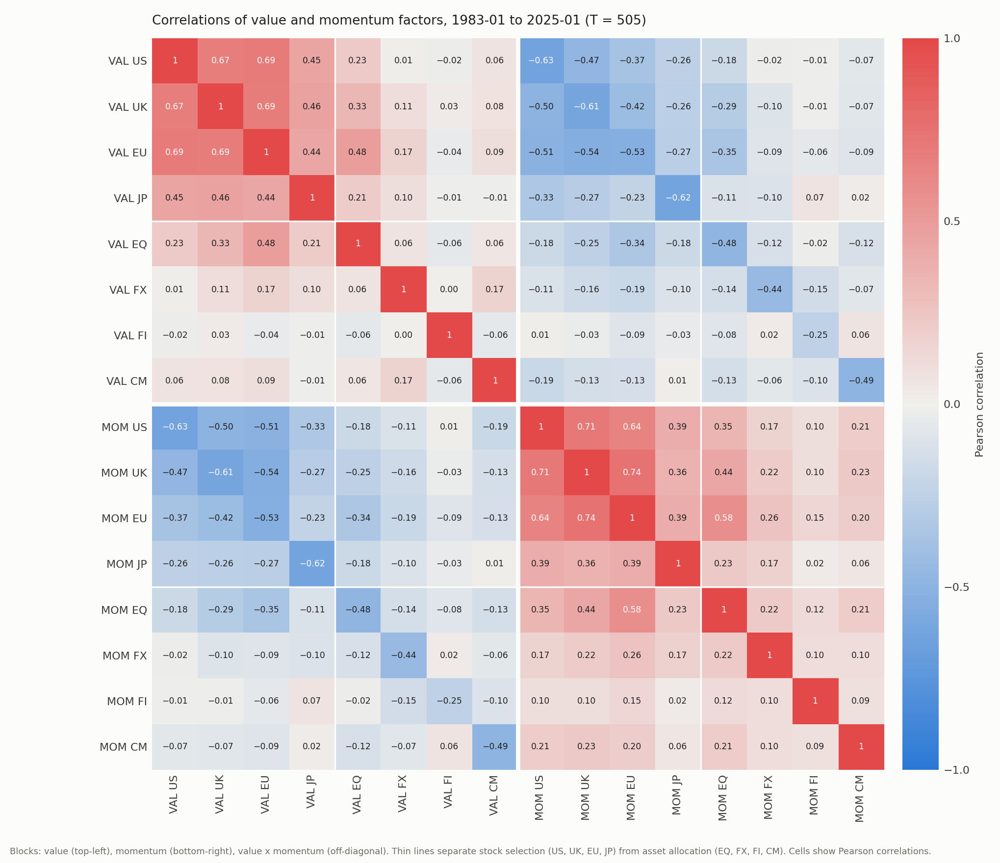

# MGT 595 Problem Set 9 — Person A: Questions (a)–(g) and (j)

**Data and conventions.**
- **Data.** We use the 16 long-short factors on the *Value and momentum factors* sheet: value (VAL) and momentum (MOM) in four stock-selection markets (US, UK, EU, JP) and four asset-allocation markets (equity index futures EQ, currencies FX, government bonds FI, commodities CM).
- **Returns and missing data.** Returns are monthly decimal excess returns. Missing months are dropped, never set to zero.
- **Samples.** Single-strategy statistics use each strategy's own sample. Comparisons across strategies use the same months. All 16 series are available from **1983-01 to 2025-01 (T = 505)**.
- **Sharpe ratios.** SR (mo) = mean/SD, with SD using divisor T − 1, and SR (ann) = √12 × SR (mo).
- **Sharpe-ratio CIs.** A 95% CI is SR (mo) ± 1.96·SE, multiplied by √12. The normal SE is √[(1 + ½SR²)/T]. The non-normal (Mertens 2002) SE is √[(1 + ½SR² − γ₃SR + ¼(γ₄−3)SR²)/T], where γ₃ is skewness and γ₄ is Pearson kurtosis (normal = 3).
- **Tail frequencies.** We count months with r − mean below −3·SD or above +3·SD. A normal distribution gives 0.27% in total.
- **Lo (2002).** The serial-correlation adjustment is kept separate from the Mertens CIs.
- **Maximum drawdown.** MDD = (L − P)/P on compounded wealth starting at 1. The duration runs from the peak to the first month wealth regains P, and a drawdown that never recovers is marked \*.

## Question (a): Summary statistics and Sharpe-ratio confidence intervals

**Table A1. Value and momentum strategies (each strategy's own sample)**

| Strategy | Sample | T | Mean (%/mo) | t(mean) | SR (mo) | SR (ann) | Skew | Kurt | 95% CI normal (ann) | 95% CI non-normal (ann) | % < −3σ | % > +3σ | % beyond ±3σ |
|---|---|---:|---:|---:|---:|---:|---:|---:|---|---|---:|---:|---:|
| VAL US | 1972-02–2026-05 | 652 | 0.197 | 1.17 | 0.046 | 0.159 | −0.20 | 13.58 | [−0.107, 0.425] | [−0.109, 0.427] | 0.61 | 0.92 | 1.53 |
| MOM US | 1972-02–2026-05 | 652 | 0.584 | 3.35 | 0.131 | 0.455 | −0.13 | 10.19 | [0.188, 0.722] | [0.181, 0.728] | 0.92 | 0.61 | 1.53 |
| VAL UK | 1981-07–2026-05 | 539 | 0.247 | 1.41 | 0.061 | 0.210 | −0.26 | 11.64 | [−0.082, 0.503] | [−0.086, 0.506] | 0.74 | 0.93 | 1.67 |
| MOM UK | 1972-01–2026-05 | 653 | 0.621 | 3.77 | 0.148 | 0.511 | −0.53 | 7.79 | [0.244, 0.779] | [0.231, 0.792] | 1.53 | 1.07 | 2.60 |
| VAL EU | 1981-07–2026-05 | 539 | 0.239 | 1.78 | 0.077 | 0.265 | −0.11 | 9.25 | [−0.027, 0.558] | [−0.030, 0.561] | 0.37 | 1.11 | 1.48 |
| MOM EU | 1974-02–2026-05 | 628 | 0.690 | 4.76 | 0.190 | 0.658 | −0.76 | 8.14 | [0.384, 0.931] | [0.360, 0.955] | 0.96 | 0.32 | 1.27 |
| VAL JP | 1981-07–2026-05 | 539 | 0.651 | 3.79 | 0.163 | 0.565 | 0.02 | 7.68 | [0.271, 0.859] | [0.267, 0.863] | 0.56 | 0.74 | 1.30 |
| MOM JP | 1974-02–2026-05 | 628 | 0.178 | 1.00 | 0.040 | 0.138 | −0.44 | 6.06 | [−0.133, 0.409] | [−0.135, 0.412] | 1.11 | 0.96 | 2.07 |
| VAL EQ | 1977-03–2025-01 | 575 | 0.243 | 2.15 | 0.090 | 0.310 | 0.10 | 4.14 | [0.027, 0.594] | [0.027, 0.593] | 0.52 | 0.35 | 0.87 |
| MOM EQ | 1977-03–2025-01 | 575 | 0.418 | 3.22 | 0.134 | 0.465 | −0.33 | 4.63 | [0.180, 0.749] | [0.173, 0.756] | 1.04 | 0.17 | 1.22 |
| VAL FX | 1979-01–2025-01 | 553 | 0.198 | 2.17 | 0.092 | 0.319 | 0.34 | 5.26 | [0.030, 0.609] | [0.034, 0.605] | 0.36 | 0.72 | 1.08 |
| MOM FX | 1979-01–2025-01 | 553 | 0.150 | 1.50 | 0.064 | 0.221 | −0.43 | 4.10 | [−0.068, 0.510] | [−0.072, 0.514] | 0.90 | 0.18 | 1.08 |
| VAL FI | 1983-01–2025-01 | 505 | 0.045 | 0.69 | 0.031 | 0.106 | 1.60 | 16.65 | [−0.197, 0.408] | [−0.190, 0.401] | 0.79 | 1.39 | 2.18 |
| MOM FI | 1983-01–2025-01 | 505 | 0.048 | 0.83 | 0.037 | 0.128 | 0.12 | 6.75 | [−0.174, 0.430] | [−0.174, 0.430] | 1.19 | 1.19 | 2.38 |
| VAL CM | 1972-01–2025-01 | 637 | 0.580 | 2.30 | 0.091 | 0.316 | 0.07 | 4.65 | [0.046, 0.586] | [0.047, 0.585] | 0.47 | 0.78 | 1.26 |
| MOM CM | 1972-01–2025-01 | 637 | 0.670 | 2.74 | 0.109 | 0.376 | 0.08 | 5.34 | [0.106, 0.646] | [0.106, 0.645] | 0.47 | 0.78 | 1.26 |

*Notes:* CIs are annualized. The tail columns are percentages of months.

**Premia.** Momentum has a significant premium in the US, UK, EU, EQ and CM (t ≥ 2.74). Value is significant in JP, EQ, FX and CM (t ≥ 2.15). Neither factor is significant in bonds. The CIs are wide, about ±0.28 in annual SR, and 7 of the 16 normal CIs include zero.

**Non-normality.** All series have fat tails: kurtosis ranges from 4.10 to 16.65, and 0.87% to 2.60% of months lie beyond ±3σ, against 0.27% under normality. The extremes are asymmetric. Momentum's are mostly losses (6 of 8 series have more months below −3σ than above +3σ), while value's are mostly gains (7 of 8).

**Normal vs non-normal CIs.** The Mertens interval is wider for 10 strategies and narrower for 6. All 6 narrower ones have positive skewness. The largest difference is MOM EU: its non-normal SE is 8.9% larger, and the interval goes from [0.384, 0.931] to [0.360, 0.955]. Table A2 shows why.

**Table A2. Terms of the Mertens variance, T·Var(SR), for selected strategies**

| Strategy | SR (mo) | Skew γ₃ | Excess kurt γ₄−3 | 1 + ½SR² | −γ₃·SR | ¼(γ₄−3)·SR² | SE ratio | Δ CI width (ann) |
|---|---:|---:|---:|---:|---:|---:|---:|---:|
| MOM EU | 0.190 | −0.76 | 5.14 | 1.018 | +0.144 | +0.046 | 1.089 | +0.049 |
| MOM UK | 0.148 | −0.53 | 4.79 | 1.011 | +0.078 | +0.026 | 1.050 | +0.027 |
| VAL US | 0.046 | −0.20 | 10.58 | 1.001 | +0.009 | +0.006 | 1.007 | +0.004 |
| VAL FI | 0.031 | 1.60 | 13.65 | 1.000 | −0.049 | +0.003 | 0.977 | −0.014 |

*Notes:* The normal variance is 1 + ½SR². The Mertens variance adds the next two columns. SE ratio = non-normal SE / normal SE.

The skewness term enters with SR and the kurtosis term with SR², and monthly SRs are small (0.03–0.19), so skewness drives most of the difference. MOM EU combines the most negative skewness (−0.76) with the highest SR, so its skewness term is the largest. VAL FI has the highest kurtosis (16.65), but with an SR of only 0.031 its kurtosis term is just +0.003, and its positive skewness makes the interval narrower.

**Serial correlation (Lo 2002).** Ljung–Box(12) rejects zero autocorrelation for 8 of 16 series at 5%. Stock-selection value is the clearest case. With ρ₁ = 0.13–0.23, its annualization factor η(12) is 2.70–2.91 instead of √12 = 3.46, so √12 overstates these annual Sharpe ratios; VAL JP, for example, falls from 0.565 to 0.440. We scale the normal SE by the same η(12), which keeps this adjustment separate from the Mertens one. This treats the autocorrelations as known and is simpler than Lo's full GMM variance. The adjusted CIs are in `output/qa_results_table.md` (Table A5).

### AI Integration (a)

**Our prediction.** I expected momentum strategies to be more affected by the non-normality adjustment, since momentum returns can experience sharp reversals and large losses. I also expected the non-normal Sharpe ratio confidence intervals to generally be wider than the normal ones for strategies with negative skewness and high kurtosis, because these features indicate greater tail risk.

**AI formulas and code.** Claude Code wrote our code from the assignment's formulas. We also asked ChatGPT to state the standard-error formulas and write Python for the normal, non-normal and serial-correlation calculations, then ran its code on our data (`ai_logs/qa_ai_interaction_log.md`).

**(i)** ChatGPT stated the normal and Mertens formulas correctly, using ordinary (Pearson) kurtosis, and did not just rescale the normal interval. It kept Lo's η annualization as a separate step, and its η(12) matches ours. However, its serial-correlation interval uses a Newey–West SE of the Sharpe ratio's influence function, which also carries the skewness and kurtosis effect: with zero lags it equals the Mertens SE exactly. That interval therefore combines the two corrections the assignment asks us to keep apart. It also warned that scaling an SE by Lo's factor is not a full GMM correction, which is why we describe our η-scaled interval as an approximation.

**(ii)** ChatGPT's code ran as written. Our own code needed one fix: `row.skew` returned the pandas method instead of the skewness column, which crashed the table output, so we switched to `row['skew']`. We then checked the results in several ways. In both codes the Mertens SE equals the normal SE exactly when γ₃ = 0 and γ₄ = 3. ChatGPT's code reproduced our kurtosis and η(12) to 5×10⁻⁹ and our Mertens-to-normal SE ratios to 0.00008; its Sharpe ratios differ from ours by at most 0.00015 because it divides by the population SD. An i.i.d. bootstrap SE for MOM EU (0.0435) is close to the Mertens SE (0.0439) rather than the normal SE (0.0403). One easy mistake is to plug the annual SR into the Mertens formula: for MOM EU, that would raise the SE ratio from 1.089 to 1.366.

**(iii)** Yes, for the most non-normal momentum series. MOM UK has the most months beyond ±3σ (2.60%), and its interval widens by 0.027. MOM EU has the largest difference, driven by its −γ₃·SR term of +0.144. The effect is not universal: VAL FI has the fattest tails but a narrower interval, because its skewness is positive.

**Comparison with our prediction.** The momentum part of the prediction holds: the five largest widenings are all momentum strategies. But MOM FI and MOM CM have positive skewness and barely change, so the driver is negative skewness rather than momentum itself. The second part holds for negative skewness but not for kurtosis. High kurtosis on its own matters little (Table A2), and all 6 intervals that get narrower belong to positively skewed strategies.

## Question (b): Are value and momentum premia equal across markets?

**Method.** For k strategies we test H₀: μ₁ = … = μ_k with the Wald statistic W = T(Rμ̂)′(RΣ̂R′)⁻¹(Rμ̂) ~ χ²(k−1), where R = [1, −I]. Because Σ̂ is the full covariance matrix, the test accounts for the correlation between strategies in the same month, which is why we use one joint test instead of pairwise t-tests. We report three versions. The Wald test assumes i.i.d. returns. The exact F version, F = (T−q)/(q(T−1))·W, also assumes normality. The Newey–West version replaces Σ̂ with a Bartlett long-run covariance (L = ⌊4(T/100)^(2/9)⌋ = 5–6 lags) to allow for serial correlation. Each test uses the months in which all k series exist. "Equity markets" means the four stock-selection markets; adding equity index futures (EQ) is a sensitivity check.

**Table B1. Joint tests of equal mean returns**

| Test | Common sample | T | k | Wald χ² (df) | p (Wald) | p (exact F) | p (Newey–West) | Reject at 5%? Wald / F / NW |
|---|---|---:|---:|---:|---:|---:|---:|---|
| Value, all 8 markets | 1983-01–2025-01 | 505 | 8 | 13.68 (7) | 0.057 | 0.063 | 0.080 | No/No/No |
| Value, 4 equity markets | 1981-07–2026-05 | 539 | 4 | 7.97 (3) | 0.047 | 0.048 | 0.072 | Yes/Yes/No |
| Momentum, all 8 markets | 1983-01–2025-01 | 505 | 8 | 13.50 (7) | 0.061 | 0.067 | 0.025 | No/No/Yes |
| Momentum, 4 equity markets | 1974-02–2026-05 | 628 | 4 | 7.82 (3) | 0.0499 | 0.051 | 0.023 | Yes/No/Yes |
| *Sensitivity:* Value, 4 equity + EQ | 1981-07–2025-01 | 523 | 5 | 8.59 (4) | 0.072 | 0.075 | 0.122 | No/No/No |
| *Sensitivity:* Momentum, 4 equity + EQ | 1977-03–2025-01 | 575 | 5 | 10.09 (4) | 0.039 | 0.041 | 0.038 | Yes/Yes/Yes |

*Notes:* The 5% χ² critical values are 14.07 (df 7), 9.49 (df 4) and 7.81 (df 3). Results with 12 lags and with volatility-scaled returns are in `output/qb_results_table.md`.

**Answer.** The decision depends on which version of the test we use.
- **Value, all 8 markets.** Equality is not rejected under any version (p = 0.057 to 0.080).
- **Value, 4 equity markets.** Equality is rejected by the Wald test (p = 0.047) and the F test (p = 0.048), but not by Newey–West (p = 0.072) or when EQ is added (p = 0.072).
- **Momentum, all 8 markets.** Equality is rejected only by Newey–West (p = 0.025, against 0.061 for Wald).
- **Momentum, 4 equity markets.** The Wald p-value is 0.0499, right at the 5% line. The F test does not reject (p = 0.051), while Newey–West does (p = 0.023).

Allowing for serial correlation weakens the case against equal value premia and strengthens it for momentum. Overall the evidence against equal premia is marginal and not robust across methods. It is somewhat stronger for momentum.

**Interpretation.**
- **Not rejecting is not proof of equality.** The SE of a single monthly mean is about 0.13–0.18% for the equity strategies, so differences of 0.2–0.3% per month are hard to detect.
- **Japan drives the equity results.** Japanese value earns 0.65% per month, against 0.14–0.25% in the other three markets. Japanese momentum earns 0.18%, against 0.54–0.69%.
- **Volatility explains much of the raw differences across asset classes.** After scaling each series to 10% volatility, the all-market tests are far from rejection (p = 0.25 for value and 0.23 for momentum). These p-values are approximate because the scaling uses estimated volatilities.

## Question (c): Maximum drawdown and its duration

**Table C1. Maximum drawdown on compounded wealth (each strategy's own sample)**

| Strategy | Sample | MDD | MDD / ann. vol | Peak | Trough | Recovery | Peak→trough (m) | Peak→recovery (m) | Status |
|---|---|---:|---:|---|---|---|---:|---:|---|
| VAL US | 1972-02–2026-05 | −70.3% | −4.71 | 1998-05 | 2000-02 | 2004-01 | 21 | 68 | Recovered |
| MOM US | 1972-02–2026-05 | −53.0% | −3.44 | 2000-02 | 2001-01 | 2008-06 | 11 | 100 | Recovered |
| VAL UK | 1981-07–2026-05 | −69.4% | −4.92 | 1995-05 | 2000-02 | 2003-06 | 57 | 97 | Recovered |
| MOM UK | 1972-01–2026-05 | −57.9% | −3.97 | 2000-02 | 2001-01 | 2002-09 | 11 | 31 | Recovered |
| VAL EU | 1981-07–2026-05 | −61.6% | −5.71 | 2009-08 | 2020-10 | — | 134 | ≥201* | Unresolved |
| MOM EU | 1974-02–2026-05 | −45.1% | −3.58 | 2009-02 | 2009-09 | 2013-12 | 7 | 58 | Recovered |
| VAL JP | 1981-07–2026-05 | −69.9% | −5.05 | 1996-10 | 2000-02 | 2002-09 | 40 | 71 | Recovered |
| MOM JP | 1974-02–2026-05 | −51.7% | −3.35 | 2000-02 | 2021-03 | — | 253 | ≥315* | Unresolved |
| VAL EQ | 1977-03–2025-01 | −50.5% | −5.37 | 2006-08 | 2022-08 | — | 192 | ≥221* | Unresolved |
| MOM EQ | 1977-03–2025-01 | −19.5% | −1.81 | 1992-10 | 1994-11 | 1997-06 | 25 | 56 | Recovered |
| VAL FX | 1979-01–2025-01 | −22.8% | −3.06 | 2003-09 | 2007-10 | 2009-03 | 49 | 66 | Recovered |
| MOM FX | 1979-01–2025-01 | −30.4% | −3.72 | 2009-01 | 2021-11 | — | 154 | ≥192* | Unresolved |
| VAL FI | 1983-01–2025-01 | −22.2% | −4.36 | 1985-06 | 1992-07 | 1995-04 | 85 | 118 | Recovered |
| MOM FI | 1983-01–2025-01 | −17.8% | −3.99 | 1986-04 | 1988-01 | 1991-10 | 21 | 66 | Recovered |
| VAL CM | 1972-01–2025-01 | −72.9% | −3.31 | 1996-10 | 2007-10 | 2019-11 | 132 | 277 | Recovered |
| MOM CM | 1972-01–2025-01 | −70.0% | −3.27 | 2008-06 | 2023-12 | — | 186 | ≥199* | Unresolved |

*Notes:* MDD / ann. vol divides the drawdown by annualized volatility. Durations are in months. \* = not recovered by the strategy's last observation, so the duration is a lower bound.

**Results.**
- **Depth.** The deepest drawdowns are VAL CM (−72.9%), VAL US (−70.3%) and MOM CM (−70.0%). Relative to volatility, stock-selection value is worst, at −4.71 to −5.71 annual volatilities. VAL US, VAL UK and VAL JP all hit their troughs in 2000-02.
- **Shape.** Momentum falls quickly: MOM US and MOM UK fell for 11 months to 2001-01, and MOM EU for 7 months in 2009. Value drawdowns build slowly: VAL EU fell for 134 months and VAL EQ for 192.
- **Duration.** Recovery takes much longer than the fall. Recovered drawdowns lasted 31–277 months (median 68). MOM US fell for 11 months and then needed 89 more to recover.
- **Unrecovered.** 5 maximum drawdowns have not recovered by the end of the sample: VAL EU, MOM JP, VAL EQ, MOM FX, MOM CM.

### AI Integration (c)

**Our algorithm.** We compute the drawdown in five steps:
1. Build cumulative wealth from the monthly returns.
2. Find the largest fall from a running peak on that wealth path.
3. Find the first month after the trough in which wealth regains the peak.
4. Measure the duration from the peak to that recovery.
5. Flag the drawdown as right-censored if wealth never recovers.

**AI implementation.** Claude Code implemented this algorithm. We also gave the algorithm to ChatGPT, asked it to write Python for both quantities, and tested its code on the same cases and on our data (`ai_logs/qc_ai_interaction_log.md`).

**(i)** Both versions build compounded wealth, track the running maximum, take the peak from before the trough and measure duration to recovery. Constructed cases confirm this. Two −10% months give −19.0%, not −10%. A −50% month followed by +300% gives −50%, not the −75% that a global max/min rule would give. A −20% fall followed by +1% per month takes 24 months to recover, not 1.

**(ii)** Our code had two small bugs, neither of which affected any drawdown: a supplementary "same episode" flag compared spell lengths instead of peak dates, and a self-check would have crashed if the starting value were the peak. The required tests pass for both our code and ChatGPT's code, which needed no changes. A rising series gives a drawdown of 0, and a single known drop gives exactly −20.000%. A second, episode-by-episode calculation reproduces all 16 drawdowns, dates and durations, and so does ChatGPT's code.

**(iii)** When wealth never regains the peak, both versions leave the recovery date empty and measure the duration to the last observation. Our code reports it as "≥ N" months, using each strategy's own end date. These durations are lower bounds, and the depth of an open drawdown can still get worse. ChatGPT's code handled censoring the same way and flags it with `right_censored=True`; its response also raised the caveat that such a duration must be reported as censored, not as a completed recovery. Both codes flag the same five unrecovered strategies.

## Question (d): Global value and momentum factors

**Method.** Over the common sample, each market's factor gets weight wᵢ = (1/σᵢ)/Σⱼ(1/σⱼ), and the global return is Σᵢ wᵢrᵢ,t with fixed weights. We build the factors ourselves from the eight underlying strategies; the AMP series in the workbook are used only as an outside check. The weighting gives every market the same *weighted stand-alone volatility*, wᵢσᵢ. It does not give every market the same share of portfolio variance, because that also depends on how each market co-moves with the rest. Since the volatilities are estimated over the whole sample, these are in-sample constructions.

**Table D1. Inverse-volatility weights**

| Weight | US | UK | EU | JP | EQ | FX | FI | CM |
|---|---:|---:|---:|---:|---:|---:|---:|---:|
| VALeverywhere | 0.083 | 0.089 | 0.117 | 0.091 | 0.138 | 0.170 | 0.248 | 0.064 |
| MOMeverywhere | 0.083 | 0.084 | 0.100 | 0.083 | 0.124 | 0.163 | 0.294 | 0.068 |

**Table D2. Global factors (1983-01 to 2025-01, T = 505)**

| Statistic | VALeverywhere | MOMeverywhere |
|---|---:|---:|
| Mean (% per month) | 0.212 | 0.278 |
| t-statistic of mean | 3.02 | 3.43 |
| Volatility (annualized) | 5.47% | 6.31% |
| Sharpe ratio, monthly | 0.134 | 0.153 |
| Sharpe ratio, annualized | 0.465 | 0.528 |
| 95% CI normal (annualized) | [0.161, 0.768] | [0.225, 0.832] |
| 95% CI non-normal (annualized) | [0.147, 0.783] | [0.214, 0.843] |
| Skewness | −0.49 | −0.38 |
| Kurtosis (Pearson) | 10.16 | 5.18 |
| % of months < −3σ / > +3σ / beyond ±3σ | 0.79 / 0.99 / 1.78 | 0.79 / 0.59 / 1.39 |
| Maximum drawdown | −29.8% | −20.1% |
| Peak → trough → recovery | 1997-10 → 2000-02 → 2001-06 | 2009-02 → 2009-09 → 2015-09 |
| Peak→trough / peak→recovery (months) | 28 / 44 | 7 / 79 |

*Notes:* \* = right-censored.

**Results.**
- **Significance.** Both global factors have significant premia, and both CIs exclude zero.
- **Diversification across markets.** On the same months, the average stand-alone annual SR of the eight components is 0.25 for value and 0.32 for momentum. The global factors reach 0.46 and 0.53, because the components are only weakly correlated (see (g)).
- **Value vs momentum.** Momentum has the higher SR, thinner tails and a smaller drawdown. Each SR has a standard error of about 0.15 per year, so a difference of 0.06 is small relative to the estimation error.
- **Value's drawdown.** It is −5.44 annual volatilities, worse than 6 of the 8 single value factors on the same months. Its trough in 2000-02 is the same month in which US, UK and JP value bottomed, so diversifying across markets did little in that episode.
- **Correlation.** The two global factors are correlated −0.62.
- **Lo.** The adjustment would lower VALeverywhere's annual SR to 0.364. MOMeverywhere is almost unchanged (0.541).
- **Check against AMP.** As an outside check only, our factors correlate 0.991 and 0.995 with the AMP series.

## Question (e): 50/50 value + momentum within each market

**Method.** In each market we hold equal capital in the two factors, R_combo,t = 0.5·R_VAL,t + 0.5·R_MOM,t, using the months in which both legs exist. Table E2 compares value, momentum and the combination on identical dates. A common-sample version (1983–2025) is saved in `output/qe_comparison.csv` for (f) and (g).

**Table E1. 50/50 combinations (each market's overlapping sample)**

| Market | Sample | T | Mean (%/mo) | t(mean) | SR (mo) | SR (ann) | Skew | Kurt | 95% CI normal (ann) | 95% CI non-normal (ann) | % < −3σ | % > +3σ | % beyond ±3σ | MDD | Peak→recovery (m) |
|---|---|---:|---:|---:|---:|---:|---:|---:|---|---|---:|---:|---:|---:|---:|
| US | 1972-02–2026-05 | 652 | 0.391 | 5.16 | 0.202 | 0.699 | 0.61 | 13.22 | [0.431, 0.968] | [0.433, 0.965] | 0.77 | 0.61 | 1.38 | −25.6% | 208 |
| UK | 1981-07–2026-05 | 539 | 0.484 | 5.94 | 0.256 | 0.887 | 0.33 | 4.99 | [0.589, 1.184] | [0.597, 1.176] | 0.56 | 0.93 | 1.48 | −24.8% | 88 |
| EU | 1981-07–2026-05 | 539 | 0.420 | 5.74 | 0.247 | 0.856 | 0.12 | 4.61 | [0.559, 1.153] | [0.560, 1.152] | 0.74 | 0.37 | 1.11 | −19.1% | 103 |
| JP | 1981-07–2026-05 | 539 | 0.397 | 4.88 | 0.210 | 0.729 | 0.07 | 5.73 | [0.433, 1.025] | [0.431, 1.027] | 0.37 | 0.93 | 1.30 | −21.2% | 105 |
| EQ | 1977-03–2025-01 | 575 | 0.330 | 4.99 | 0.208 | 0.722 | 0.16 | 4.15 | [0.435, 1.008] | [0.438, 1.005] | 0.52 | 0.35 | 0.87 | −21.3% | ≥207* |
| FX | 1979-01–2025-01 | 553 | 0.174 | 3.42 | 0.145 | 0.503 | 0.99 | 11.01 | [0.213, 0.793] | [0.228, 0.778] | 0.54 | 0.72 | 1.27 | −14.6% | ≥99* |
| FI | 1983-01–2025-01 | 505 | 0.046 | 1.22 | 0.054 | 0.189 | 1.58 | 17.51 | [−0.114, 0.491] | [−0.102, 0.479] | 0.79 | 0.99 | 1.78 | −7.7% | 90 |
| CM | 1972-01–2025-01 | 637 | 0.625 | 5.05 | 0.200 | 0.694 | 0.26 | 4.51 | [0.422, 0.965] | [0.427, 0.960] | 0.47 | 0.31 | 0.78 | −28.7% | ≥76* |

**Table E2. Value, momentum and the combination on the same dates**

| Market | ρ(VAL, MOM) | SR VAL | SR MOM | SR combo | ΔSR vs better leg | MDD VAL | MDD MOM | MDD combo | Combo vol / avg. leg vol |
|---|---:|---:|---:|---:|---:|---:|---:|---:|---:|
| US | −0.61 | 0.16 | 0.45 | 0.70 | +0.24 | −70.3% | −53.0% | −25.6% | 0.44 |
| UK | −0.61 | 0.21 | 0.56 | 0.89 | +0.32 | −69.4% | −57.9% | −24.8% | 0.45 |
| EU | −0.52 | 0.27 | 0.56 | 0.86 | +0.30 | −61.6% | −45.1% | −19.1% | 0.50 |
| JP | −0.62 | 0.56 | 0.11 | 0.73 | +0.16 | −69.9% | −51.7% | −21.2% | 0.44 |
| EQ | −0.41 | 0.31 | 0.46 | 0.72 | +0.26 | −50.5% | −19.5% | −21.3% | 0.54 |
| FX | −0.44 | 0.32 | 0.22 | 0.50 | +0.18 | −22.8% | −30.4% | −14.6% | 0.53 |
| FI | −0.25 | 0.11 | 0.13 | 0.19 | +0.06 | −22.2% | −17.8% | −7.7% | 0.62 |
| CM | −0.50 | 0.32 | 0.38 | 0.69 | +0.32 | −72.9% | −70.0% | −28.7% | 0.50 |

*Notes:* Sharpe ratios are annualized. ΔSR = SR of the combination minus the better leg's SR. The last column is the combination's volatility divided by the average of the two legs' volatilities.

**Results.**
- **Sharpe ratio.** Combining value and momentum improves the Sharpe ratio over the better leg in all 8 markets. The same holds on the common sample (8 of 8).
- **Why it improves.** The combination's mean is just the average of the two legs, so it is lower than the higher-mean leg. The gain comes from volatility. Value and momentum are negatively correlated everywhere (−0.25 to −0.62), so the combination's volatility is only 0.44–0.62 of the average leg volatility.
- **Drawdowns.** The combination has a smaller maximum drawdown than either leg in 7 of 8 markets. The exception is EQ (−21.3% vs momentum's −19.5%): VAL EQ's long 2006–2022 drawdown still dominates.
- **Largest and smallest gains.** The largest gains are in the UK and CM (ΔSR +0.32 and +0.32). The smallest is in bonds (+0.06), where both legs are weak and the correlation is the least negative; the bond combination is not significant (t = 1.22).
- **Why 50/50 is not guaranteed to help.** Equal weighting is not optimal when one leg is much weaker. Japan has the most negative correlation but a gain of only +0.16, because Japanese momentum is weak (SR 0.11). The in-sample Sharpe-maximizing weight on value in Japan is 0.61, giving SR 0.814 instead of 0.729.
- **Tails.** All eight combinations have positive skewness, and seven of them have smaller maximum drawdowns than either individual factor. These are in-sample results and do not mean crash risk is gone: the combinations still had drawdowns of −7.7% to −28.7%, and three have not recovered.

## Question (f): Global value + momentum factor

**Method.** We weight the eight 50/50 combinations from (e) by the inverse of their common-sample volatility. The weights are US 0.099, UK 0.101, EU 0.113, JP 0.102, EQ 0.131, FX 0.162, FI 0.226, CM 0.067. As in (d), this equalizes weighted stand-alone volatility, not contributions to portfolio variance. It is an in-sample construction, not a real-time backtest.

**Table F1. Global value + momentum factor compared with the (d) factors (same 505 months)**

| Statistic | Global VAL+MOM (f) | VALeverywhere (d) | MOMeverywhere (d) | 50/50 blend of (d) |
|---|---:|---:|---:|---:|
| Mean (% per month) | 0.263 | 0.212 | 0.278 | 0.245 |
| t-statistic of mean | 7.38 | 3.02 | 3.43 | 7.38 |
| Volatility (annualized) | 2.77% | 5.47% | 6.31% | 2.58% |
| Sharpe ratio, monthly | 0.329 | 0.134 | 0.153 | 0.328 |
| Sharpe ratio, annualized | 1.138 | 0.465 | 0.528 | 1.138 |
| 95% CI normal (annualized) | [0.828, 1.448] | [0.161, 0.768] | [0.225, 0.832] | [0.828, 1.448] |
| 95% CI non-normal (annualized) | [0.840, 1.436] | [0.147, 0.783] | [0.214, 0.843] | [0.841, 1.435] |
| Skewness | 0.45 | −0.49 | −0.38 | 0.46 |
| Kurtosis (Pearson) | 5.54 | 10.16 | 5.18 | 5.31 |
| % of months < −3σ / > +3σ / beyond ±3σ | 0.40 / 0.20 / 0.59 | 0.79 / 0.99 / 1.78 | 0.79 / 0.59 / 1.39 | 0.20 / 0.59 / 0.79 |
| Maximum drawdown | −11.7% | −29.8% | −20.1% | −11.4% |
| Peak → trough → recovery | 2018-01 → 2021-08 → not recovered | 1997-10 → 2000-02 → 2001-06 | 2009-02 → 2009-09 → 2015-09 | 2018-01 → 2021-08 → not recovered |
| Peak→trough / peak→recovery (months) | 43 / ≥84* | 28 / 44 | 7 / 79 | 43 / ≥84* |

*Notes:* Sharpe ratios are the conventional √12-annualized values. "Blend" = 0.5·VALeverywhere + 0.5·MOMeverywhere. \* = has not regained its 2018 peak by 2025-01.

**Results.**
- **Sharpe ratio.** The global value + momentum factor has an annual SR of 1.14, against 0.46 and 0.53 for the global value and momentum factors. Its mean (0.263% per month) lies between theirs, so the higher SR comes from lower volatility: 2.77% against 5.47% and 6.31%.
- **Tails and drawdown.** Skewness becomes positive, and the maximum drawdown shrinks to −11.7%.
- **Order of combining.** Combining within markets first gives different weights on the 16 factors than blending the two global factors: 41.5% vs 36.5% in stock selection, and 22.6% vs 27.1% in bonds. In practice the two series correlate 0.994, with a tracking error of 0.35% a year and the same SR to three decimals. The two methods produce almost identical Sharpe ratios in this sample, despite differences in portfolio weights and volatility.
- **Serial correlation.** The factor is positively autocorrelated (ρ₁ = 0.10). The separate Lo adjustment (η(12) = 2.58) would lower the annual SR from 1.14 to 0.85. This changes how the SR is annualized, not the conventional estimate in Table F1.
- **Limitations.** The weights use full-sample volatilities. The 2018–2021 drawdown is still open when the common sample ends in 2025-01. With 2.8% volatility, the strategy would need leverage to earn economically large returns.

## Question (g): Diversification across asset classes versus across factors

**Measure.** We use the diversification ratio, DR = Σwᵢσᵢ/σ_p. With fixed weights the portfolio mean does not depend on correlations, so SR_p = SR_undiversified × DR exactly, and the DR isolates the Sharpe-ratio gain that comes only from lower volatility. Under inverse-volatility weights, SR_undiversified equals the simple average of the components' SRs. Everything uses the same 505 months.

**Across markets.** Spreading across the eight markets raises the SR from the component average to 0.46 for value (from 0.25, DR 1.85), 0.53 for momentum (from 0.32, DR 1.66) and 1.14 for the eight combinations (from 0.59). For value, volatility falls from 12.0% to 5.5%, and the average MDD from −54.9% to −29.8%. Most of the benefit comes from spreading across asset classes, not countries. Correlations within stock selection are high (+0.56 for value, +0.54 for momentum), while within asset allocation they are near zero (+0.03 and +0.14).

**Across factors.** Within each market the 50/50 combination has an average DR of 2.04, and its SR beats the better leg by +0.21 on average. Globally, value and momentum are correlated −0.62, so their blend has a DR of 2.28 and an SR of 1.14, against 0.46 and 0.53.

**Which is larger?** To compare the two fairly, we take the same final portfolio and split its DR into a factor step and a market step, in both orders. With the (f) weights:
- factors first, then markets: DR = 2.04 × 1.91
- markets first, then factors: DR = 1.70 × 2.30

Both orders give 3.91. Averaging the log contributions over the two orders gives each source a share (a Shapley split).

**Table G1. Splitting the diversification of the final portfolio between the two sources**

|  | Across markets | Across factors |
|---|---:|---:|
| DR when applied first ((f) weights) | 1.70 | 2.04 |
| DR when applied second ((f) weights) | 1.91 | 2.30 |
| Shapley share of ln DR — (f) weights, 8 markets | 43% | 57% |
| Shapley share of ln DR — blend of (d) factors, 8 markets | 45% | 55% |
| Shapley share of ln DR — equal weights 1/16, 8 markets | 41% | 59% |
| Shapley share of ln DR — (f) weights, stock selection only | 22% | 78% |
| Shapley share of ln DR — (f) weights, asset allocation only | 48% | 52% |
| Average MDD after this source alone | −24.9% | −20.4% |
| Correlation that drives it | across markets: +0.19 (VAL), +0.27 (MOM) | VAL with MOM: −0.51 within markets, −0.62 globally |

*Notes:* The MDD row compares the average of VALeverywhere and MOMeverywhere (markets only) with the average of the eight combinations (factors only). The 16 single factors average −49.1%.

**Answer.** In this dataset, combining value and momentum gives the larger diversification benefit, but the margin is moderate. It has the larger DR whether it is applied first or second, accounts for 55%–59% of the log DR under all three weighting schemes, and reduces drawdowns more. It does this with two factors rather than eight markets.

These shares come from one particular decomposition and three weighting schemes, so they are a reasonable way to split the effect rather than a unique measure. The ranking also depends on the starting set. Within stock selection, factor diversification dominates (78%), because the four equity markets move together. Within asset allocation, the two sources are about equal (52% vs 48%).

The intuition is simple. For two equally volatile assets with correlation ρ, DR = 1/√((1+ρ)/2), which is about 2.01 at ρ = −0.51. Eight markets with an average correlation of 0.17 give a DR of about 1.91, well short of the √8 ≈ 2.83 that uncorrelated markets would give. Both results are in-sample, and the DR measures volatility, not crash risk: the fully diversified factor still had an unrecovered −11.7% drawdown.

## Question (j): Correlation structure

**Method.** Pearson correlations of monthly returns over the common sample (505 months, the same for every pair). Each average uses unique off-diagonal pairs. The pair lists are in `output/qj_correlation_summary.csv`, and the full matrix is in `output/qj_correlation_matrix.csv`.

*Figure J1. Correlation matrix of the 16 factors, 1983-01 to 2025-01.* Each cell shows the correlation; red is positive and blue is negative. The top-left block is value, the bottom-right block is momentum, and the off-diagonal blocks are value against momentum. Thin lines separate stock selection from asset allocation.

**Table J1. Average correlations**

| Pairs | Number | Average | Range |
|---|---:|---:|---|
| Value–value, all 8 markets | 28 | +0.19 | −0.06 to +0.69 |
| Momentum–momentum, all 8 markets | 28 | +0.27 | +0.02 to +0.74 |
| Value–momentum, all pairs | 64 | −0.20 | −0.63 to +0.07 |
| Value–momentum, same market | 8 | −0.51 | −0.63 to −0.25 |
| Value–momentum, different markets | 56 | −0.16 | −0.54 to +0.07 |
| Value, within stock selection | 6 | +0.56 | +0.44 to +0.69 |
| Momentum, within stock selection | 6 | +0.54 | +0.36 to +0.74 |
| Value, within asset allocation | 6 | +0.03 | −0.06 to +0.17 |
| Momentum, within asset allocation | 6 | +0.14 | +0.09 to +0.22 |

**What stands out.**
- **Within each style.** Value and momentum are strongly correlated across the four stock-selection markets (VAL +0.56, MOM +0.54). Across the asset-allocation markets value is almost uncorrelated (+0.03), while all 28 momentum pairs are positive. Bond value is nearly unrelated to anything except bond momentum.
- **Value against momentum.** The most negative correlations are value against momentum in the same market (US −0.63, JP −0.62). Value is also negatively correlated with momentum in *other* markets: 50 of 56 such pairs are negative, for example VAL EU and MOM UK at −0.54.
- **First principal component.** It explains 31.5% of the variance (6.25% if the series were uncorrelated). It loads negatively on all value factors and positively on all momentum factors. This is a shared statistical pattern, not evidence that it is a priced risk factor.
- **Robustness.** Dropping 1999–2001 and 2009 moves the global value–momentum correlation only from −0.624 to −0.577.

**Do the correlations surprise us?** Partly. Comovement within each style and negative value–momentum correlations were expected. More surprising is how far the negative relation reaches: value in one market hedges momentum in other markets and asset classes. Also surprising are the limits: momentum co-moves across asset classes, but value outside equities has almost no common part.

**Risk or behavior?** The correlations narrow the possible explanations but do not decide between them. A component shared across markets is what a common risk factor would produce, such as funding-liquidity risk (the assignment cites Asness, Moskowitz and Pedersen), macro conditions or a shared equity exposure. The negative value–momentum correlation does not rule this out, because one common factor produces negative correlation if value and momentum load on it with opposite signs. But correlations cannot show that the component is priced; that needs evidence that exposure to it earns a premium. Why both premia are positive is a pricing question that a correlation matrix cannot answer.

A behavioral story fits the same pattern. Momentum fits underreaction and slow price adjustment, and value fits the later correction of overreaction. If the same biases, or the same global investors, operate in every market, mispricings will be correlated across markets too.

**Other explanations.** Recent winners tend to look expensive, so value and momentum partly hold opposite positions. This fits the stronger same-market correlation (−0.51) than different-market correlation (−0.16), although the cross-market correlations show it is not the whole story. Arbitrage capital trading both styles everywhere could also spread shocks across markets, especially under leverage or funding constraints, but we cannot test this with these data. All of these are unconditional, in-sample correlations.

### AI Integration (j)

**Our interpretation.** We expected value strategies to be positively correlated across equity markets because they respond to similar conditions. We expected momentum to share common patterns across markets, and value and momentum to be negatively correlated. We did not expect this to settle risk versus behavior. The matrix supports all three expectations. Equity value correlates +0.56, all momentum pairs are positive, and all eight same-market value–momentum pairs are negative. One refinement: value's commonality is mostly limited to equities.

**LLM response.** We asked Claude the following question using the correlations from our data (`ai_logs/qj_ai_interaction_log.md`):

> "In my correlation matrix, the average within-value cross-market correlation is 0.19, the average within-momentum cross-market correlation is 0.27, and the average value–momentum correlation is −0.20. Does this pattern favor a risk-based or a behavioral explanation of the value and momentum premia?"

It answered that the pattern "doesn't settle it," that the common component "could be risk or a widespread behavioral bias," and that "the data alone don't pick between those two."

**(i)** Yes. It named both funding-liquidity risk and a pervasive behavioral bias, and did not pick a winner.

**(ii)** Mostly, but it made two errors.
- **Correct.** It did not treat a common factor as proof of risk.
- **Error 1.** It argued that "if both premia paid for the same risk, they should be positively correlated." That is wrong, because opposite-sign loadings on one factor give negative correlation. We missed this in our first review and corrected it later.
- **Error 2.** It claimed that value in Japanese equities moves with value in currencies and bonds. Our data show VAL JP at +0.10 with VAL FX and −0.01 with VAL FI.
- **Misleading.** Calling the common factor "real but weak" hides the split between strong commonality in stock selection (+0.56) and almost none in asset allocation (+0.03).

**(iii)** It got the direction right but used the wrong number. Its claim that a value–momentum mix has lower volatility and a higher SR matches (e), where the combination beats both legs in all eight markets. But it tied this to the all-pairs average (−0.20), while the relevant correlation for each 50/50 combination is the same-market one (−0.51 on average). For two equally volatile legs, ρ = −0.20 would cut volatility only to 63% of the average leg, whereas ρ = −0.51 gives 50%, close to the 0.44–0.62 we observed. We did not verify its quotation from the AMP paper, so we do not use it.
